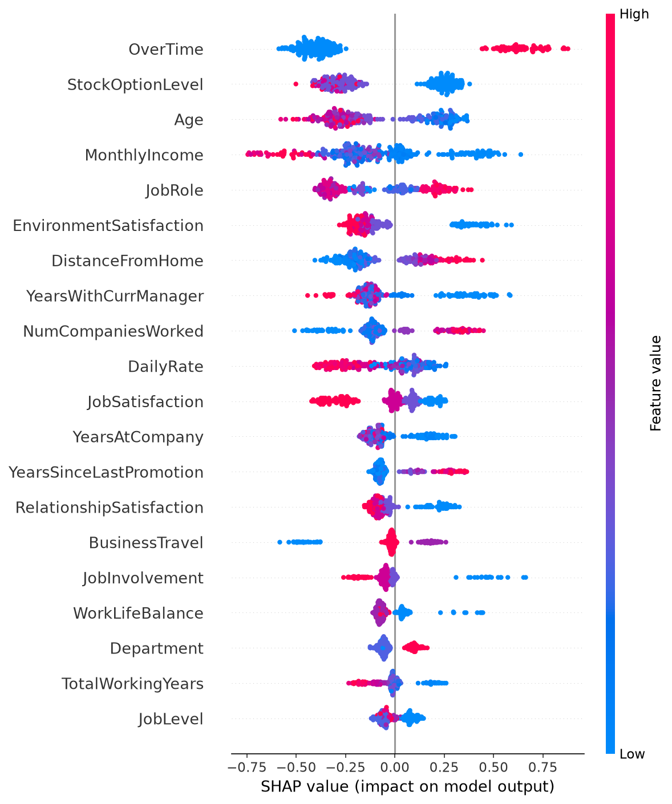
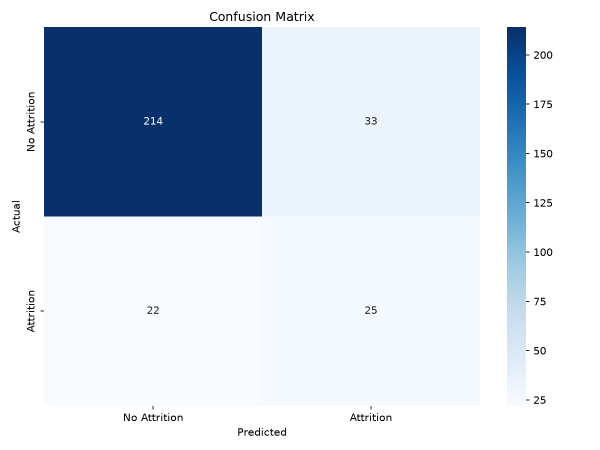

# HC-SmartPulse: Employee Attrition Risk & Talent Analytics

Predicts which employees are likely to leave, explains why with SHAP, and turns the result into prioritized HR actions through an interactive Streamlit dashboard.

[](https://www.python.org/)
[](https://xgboost.readthedocs.io/)
[](https://streamlit.io/)
[](LICENSE)

**Tech stack:** Python · pandas · scikit-learn · XGBoost · SHAP · Streamlit · Plotly · Docker

## Overview

Replacing an employee is expensive, and HR teams usually find out someone is leaving only when they resign. HC-SmartPulse uses the [IBM HR Analytics Attrition dataset](https://www.kaggle.com/datasets/pavansubhasht/ibm-hr-analytics-attrition-dataset) (1,470 employees, 16.1% attrition) to:

1. Find the factors most associated with attrition (EDA notebook)
2. Score each employee's attrition probability with an XGBoost classifier
3. Explain the drivers with SHAP
4. Recommend retention actions with a rule-based engine

## Key Findings (EDA)

From [`notebooks/01_eda.ipynb`](notebooks/01_eda.ipynb):

| Factor | Attrition rate |
|---|---|
| Overtime vs no overtime | **30.5%** vs 10.4% |
| Age 18–25 vs 36–45 | **35.8%** vs 9.2% |
| First 2 years at company vs 10+ years | **29.8%** vs 8.1% |
| Lowest income quartile vs top two quartiles | **29.3%** vs ~10% |
| Job level 1 vs level 2 | **26.3%** vs 9.7% |
| No stock options vs level 1–2 | **24.4%** vs 7.6–9.4% |
| Sales Representatives (highest-risk role) | **39.8%** |

The highest-risk profile is an **early-career, lower-paid employee working overtime**. 53.6% of leavers worked overtime, while only 28.3% of all employees do.

## Model & Results

**Approach**
- Drop constant and ID columns, label-encode categorical features, and use a stratified 80/20 train/test split.
- XGBoost with `scale_pos_weight` to handle the 16% minority class.
- `RandomizedSearchCV` (40 candidates, 5-fold) optimizing **PR-AUC**, which is threshold-independent and suited to imbalanced data.
- **Decision threshold tuned to 0.55** by maximizing F1 on out-of-fold predictions from the training set. The test set is never used for tuning.

**Test set results (294 employees, 47 leavers)**

| Model | Accuracy | Precision | Recall | F1 | PR-AUC | CV PR-AUC |
|---|---|---|---|---|---|---|
| **XGBoost (threshold 0.55)** | 81.3% | 43.1% | **53.2%** | 47.6% | 53.1% | **61.3%** |
| Logistic Regression (baseline) | 75.2% | 36.7% | 76.6% | 49.7% | 60.6% | 55.0% |
| Majority class (always "No") | 84.0% | 0.0% | 0.0% | 0.0% | 16.0% | 16.2% |

*CV PR-AUC = 5-fold cross-validated score on the training set.*

**How to read this**
- **Accuracy is misleading here.** Predicting "No" for everyone scores 84%, higher than either real model, yet it catches zero leavers.
- The model **catches 25 of 47 leavers** (53% recall), and 43% of its alerts are correct (25 true alerts vs 33 false alarms).
- **Logistic Regression is a strong baseline.** It wins on the test split, while XGBoost wins in cross-validation. With only 47 positives in the test set, the two are statistically comparable. XGBoost is kept for its higher CV PR-AUC and its tree-based SHAP explanations.

**Top drivers (mean |SHAP|):** OverTime, StockOptionLevel, Age, MonthlyIncome, JobRole, EnvironmentSatisfaction, DistanceFromHome.

<p align="center">
  
  
</p>

## Dashboard

`streamlit run app.py` opens four tabs:

| Tab | What it shows |
|---|---|
| **Dashboard** | Employee count, attrition rate, high-risk active employees, risk distribution, attrition by department, and the 5 active employees with the highest predicted risk. Department and attrition-status filters apply. |
| **Employee Risk** | A 30-field form for a single employee. Returns the predicted probability, risk tier, comparison to the active-employee average, a profile radar, and recommendations. |
| **Analytics** | SHAP feature importance, test metrics, the baseline comparison, and the confusion matrix. |
| **Export & Model Info** | CSV/Excel export of employee records with their risk score, plus model details. |

The **high-risk threshold** in the sidebar defaults to the tuned 0.55. Medium risk starts at half the threshold.

### Recommendation rules

Recommendations are generated only for employees at or above the high-risk threshold (`src/recommendation_engine.py`):

| Trigger | Category | Priority |
|---|---|---|
| OverTime = Yes | Workload Management | Critical |
| YearsSinceLastPromotion ≥ 3 | Career Development | Critical |
| JobLevel ≥ 2 and MonthlyIncome < $5,000 | Compensation Review | Critical |
| EnvironmentSatisfaction ≤ 2 | Workplace Environment | High |
| JobSatisfaction ≤ 2 | Job Satisfaction | High |
| WorkLifeBalance ≤ 2 | Work-Life Balance | High |
| RelationshipSatisfaction ≤ 2 | Manager Relationship | High |
| DistanceFromHome > 20 km | Commute Support | Medium |
| TrainingTimesLastYear = 0 | Professional Development | Medium |

## Project Structure

```
├── data/dataset.csv              # IBM HR Attrition dataset (1,470 rows)
├── notebooks/01_eda.ipynb        # Exploratory data analysis
├── src/
│   ├── data_processing.py        # Cleaning, encoding, scaling, train/test split
│   ├── model_training.py         # Tuning, threshold selection, evaluation, baselines, SHAP
│   └── recommendation_engine.py  # Risk tiers and rule-based HR recommendations
├── models/                       # Trained model, preprocessing artifacts, metrics, plots
├── app.py                        # Streamlit dashboard
├── Dockerfile
└── requirements.txt
```

## How to Run

```bash
git clone https://github.com/DianPandus/hc-smartpulse-talent-analytics.git
cd hc-smartpulse-talent-analytics
pip install -r requirements.txt

# Optional: retrain (trained artifacts are already in models/)
python src/model_training.py

streamlit run app.py               # http://localhost:8501
```

Run all commands from the project root.

**Docker**

```bash
docker build -t hc-smartpulse .
docker run -p 8501:8501 hc-smartpulse
```

**Notebook:** install Jupyter (`pip install jupyter`), then open `notebooks/01_eda.ipynb`.

## Limitations

- **Small dataset.** The test set has only 47 leavers, so metrics can shift by several points with a different split.
- **Fictional data.** The IBM dataset was created by IBM data scientists and is not real company data.
- **No timing information.** The model estimates *whether* an employee resembles past leavers, not *when* they will leave.
- **In-sample dashboard scores.** The dashboard scores all 1,470 employees, including those used for training, so those scores are optimistic. Use the test metrics above to judge real performance.
- **Label encoding** imposes an arbitrary order on nominal features such as JobRole. This works for tree models, but one-hot encoding would be cleaner for the linear baseline.

## Dataset

IBM HR Analytics Employee Attrition & Performance, available on [Kaggle](https://www.kaggle.com/datasets/pavansubhasht/ibm-hr-analytics-attrition-dataset). 1,470 employees, 35 columns, target `Attrition` (Yes/No).

## License

[MIT](LICENSE)
